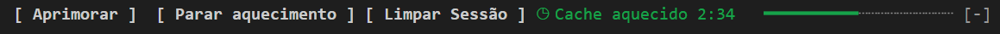
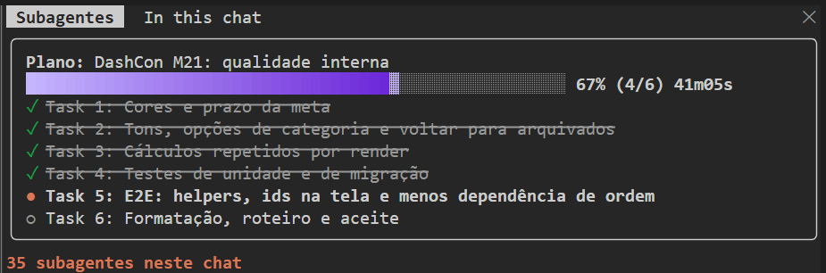
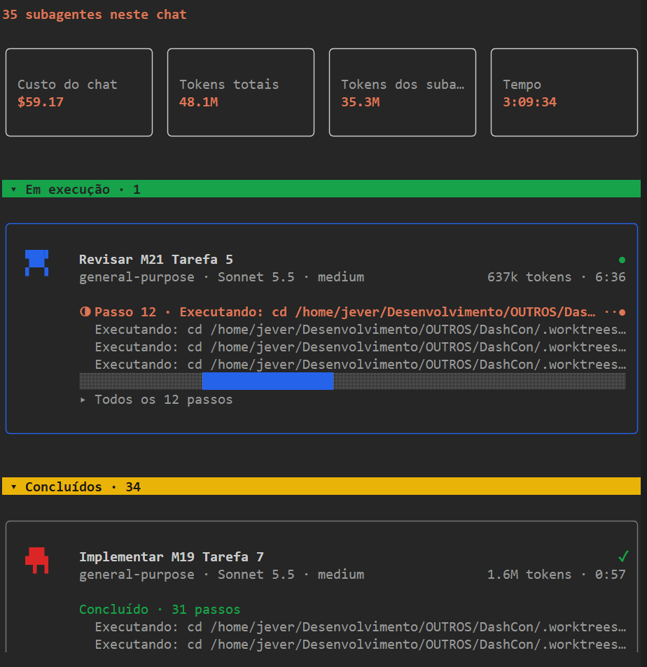

# Mods para Claude Code

Seis mods pequenos para o Claude Code. Cada um mexe em uma parte da tela do chat: a faixa acima do prompt, o painel lateral, ou um comando novo. Todos vêm do marketplace `jeverjm` e podem ser ligados e desligados pelo `/mods`.

| Mod | Versão | O que faz | Como abrir |
| --- | --- | --- | --- |
| [cache-keeper](#cache-keeper) | 0.2.6 | Contagem até o cache esfriar, Manter aquecido e Limpar Sessão | botões acima do prompt |
| [prompt-enhancer](#prompt-enhancer) | 0.3.0 | Reescreve o rascunho do prompt sem enviar e copia para a área de transferência | botão Aprimorar, `/aprimorar` |
| [plan-progress](#plan-progress) | 0.9.0 | Painel com o plano do chat e um card por subagente | `/subagentes`, ou sozinho |
| [chat-inventory](#chat-inventory) | 0.2.0 | Painel "In this chat": to-do, conectores, arquivos e skills | `/inventory` |
| [screen-share](#screen-share) | 0.2.0 | Mascara e-mails, telefones, valores e nomes na tela | `/screen-share` |
| [mods](#mods) | 0.4.0 | Painel para ligar e desligar cada mod | `/mods` |

- [Requisitos](#requisitos)
- [Instalação](#instalacao)
- [Como cada mod funciona](#como-cada-mod-funciona)
- [Imagens de uso](#imagens-de-uso)
- [Solução de problemas](#solucao-de-problemas)

## Requisitos

- Claude Code 2.1.287 ou superior. Testado no 2.1.308.
- `python3` no PATH, usado pelo cache-keeper para descobrir se o cache do chat é de 5 minutos ou de 1 hora.
- Para os painéis abrirem sozinhos, o terminal precisa ter pelo menos 144 colunas. Abaixo disso, o painel só abre pelo comando.

<a id="instalacao"></a>
## Instalação

Os mods estão neste repositório, que é também o marketplace `jeverjm`.

### Todos de uma vez

No prompt do Claude Code:

```
/plugin marketplace add Jever/Mods_Claude
/plugin install cache-keeper@jeverjm
/plugin install prompt-enhancer@jeverjm
/plugin install plan-progress@jeverjm
/plugin install chat-inventory@jeverjm
/plugin install screen-share@jeverjm
/plugin install mods@jeverjm
```

Ou pelo terminal, de uma vez:

```bash
claude plugin marketplace add Jever/Mods_Claude
for p in cache-keeper prompt-enhancer plan-progress chat-inventory screen-share mods; do
  claude plugin install "$p@jeverjm"
done
```

Depois, reinicie o Claude Code ou rode `/reload-plugins`.

### Individualmente

Instale só o que quiser. Cada mod funciona sozinho:

```
/plugin install cache-keeper@jeverjm
```

O `mods` é opcional, mas é o único jeito de ligar e desligar os outros pela tela. Sem ele, use `/screen-share` e os comandos de cada mod.

### Remover

```
/plugin uninstall cache-keeper@jeverjm
```

### Atualizar

Quem já instalou pelo GitHub atualiza em duas etapas: primeiro o marketplace, depois os plugins.

No terminal:

```bash
claude plugin marketplace update jeverjm
for p in cache-keeper prompt-enhancer plan-progress chat-inventory screen-share mods; do
  claude plugin update "$p@jeverjm"
done
```

No Claude Code:

```
/plugin marketplace update jeverjm
/plugin update cache-keeper@jeverjm
```

Reinicie o Claude Code depois. A atualização só vale após o reinício.

Se a atualização não trouxer a versão nova, confira com `claude plugin list`. Quem instalou antes do nome `jeverjm` (marketplace `meus-mods`) precisa reinstalar, porque o marketplace antigo foi removido.

## Como cada mod funciona

### cache-keeper

Mostra acima do prompt quanto tempo falta até o cache do chat esfriar. O cache é o que deixa a próxima mensagem barata. Depois de esfriar, a próxima mensagem relê o chat inteiro pelo preço cheio.

- **Contagem:** `◷ Cache aquecido 3:12` com uma barra que esvazia. Ao esfriar, mostra `❄ Frio há 7 min`. A duração (5 minutos ou 1 hora) vem do que o Claude gravou nas respostas do chat. Até a primeira resposta, o mod assume 5 minutos.
- **Manter aquecido:** manda um ping pequeno cerca de 45 segundos antes de o cache esfriar. Para sozinho depois de 30 pings, depois de 2 horas, ou quando você envia uma mensagem. Também pelo comando `/keepwarm` e `/keepwarm off`.
- **Limpar Sessão:** gera um briefing do chat, limpa a sessão e cola o briefing no prompt para você continuar em um chat limpo. Também pelo comando `/handoff`. `/handoff colar` recola o último briefing.
- **Handoff automático:** `/autohandoff 75` faz o handoff sozinho quando o contexto chega a 75%. `/autohandoff off` desliga.
- **Aviso de qualidade:** avisa quando o contexto passa de 60%. O valor é configurável no momento da instalação.

Enquanto o chat está respondendo, a faixa mostra `◷ Respondendo...`, porque o cache está sendo usado.

### prompt-enhancer

Reescreve o rascunho que você digitou no prompt, sem enviar. Você revisa e envia depois.

- **Botão Aprimorar** acima do prompt, ou tecla `a`.
- **`/aprimorar`** com o rascunho como argumento, ou sem argumento para usar o texto do prompt.
- **Copia para a área de transferência:** além de preencher a caixa, o resultado é copiado para colar em um bloco de notas ou compartilhar. Um aviso confirma a cópia.

Exemplo ilustrativo. O texto reescrito sai com cinco seções: tarefa, skills sugeridas, contexto do projeto, decisões a confirmar e resultado esperado. Usa o CLAUDE.md, o README e a lista de skills instaladas como contexto. O modelo padrão é `sonnet`, e pode ser trocado na instalação.

Exemplo, com o rascunho `arruma o login`:

```
Tarefa: corrigir o fluxo de login que falha após a expiração do token.
Skills sugeridas: (nenhuma)
Contexto do projeto: ...
Decisões a confirmar comigo antes de começar: ...
Resultado final esperado: o login renova o token sem pedir a senha de novo.
```

### plan-progress

Mostra o plano do chat e um card por subagente em um painel lateral chamado **Subagentes**.

O painel tem três partes.

1. **Caixa do plano:** objetivo do plano, barra de progresso com degradê, porcentagem, tempo e a lista de tarefas com `✓`, `●` (em andamento) e `○` (pendente).
2. **Caixas de totais:** Custo do chat, Tokens totais, Tokens dos subagentes e Tempo.
3. **Cards dos subagentes:** um por subagente, com o nome, o tipo, o modelo, o passo atual, os últimos passos, a barra de atividade e o tempo. Agrupados em Em execução, Concluídos e Interrompidos, com os mais recentes no topo de cada grupo.

O plano vem de três fontes, nesta ordem: o ledger do superpowers em `.superpowers/sdd`, incluindo worktrees; o TodoWrite e o TaskCreate do chat principal; e o arquivo `~/.claude/mods-state/plan-<sessão>.json`, que este mod também grava para o chat-inventory.

- O painel abre sozinho quando um plano ganha itens, uma vez por plano. Se você fechar, ele não reabre sozinho para o mesmo plano.
- O painel também abre sozinho quando um subagente começa.
- `/subagentes` abre quando você quiser.

Tokens totais soma o uso do chat principal com o dos subagentes, incluindo leituras de cache. Por isso o número pode passar da janela de contexto.

O **Custo do chat** é calculado pelos tokens de cada modelo e os preços em `~/.claude/mods-state/cost-models.json`, criado na primeira abertura com uma lista inicial. Edite o arquivo para ajustar os valores. Modelos fora da lista saem do total e aparecem como "Custo parcial".

### chat-inventory

Painel lateral **In this chat**, com quatro seções: To-do, Connectors, Context files e Skills. Mostra o que este chat usou até agora.

- `/inventory` abre o painel.
- Oculte e mostre pelo `/mods`, que aparece como Hidden e Shown.

O To-do vem do TodoWrite, do TaskCreate e do plano gravado pelo plan-progress. O painel `Subagentes` do plan-progress mostra o mesmo plano em outro lugar. Se você só quer um dos dois, desligue o chat-inventory ou o plan-progress.

### screen-share

Para gravar a tela ou mostrar o chat a alguém, sem vazar dados. Enquanto o modo está ligado, e-mails, telefones, valores em moeda e nomes de pessoas aparecem como barras sombreadas. O Claude continua lendo os dados reais: a mascara é só na tela.

- `/screen-share` liga e desliga. A confirmação diz o estado atual.
- Datas não são mascaradas.

Use o texto de teste abaixo para conferir antes de gravar:

```
Cliente: Ana Exemplo
E-mail de contato: ana.exemplo@example.com
Telefone: +55 11 98765-4321
Receita do mês: R$ 12.345,67
Data de vencimento: 15/03/2027
```

### mods

Painel para ligar e desligar cada mod, sem editar arquivos. Abra com `/mods`.

- **On / Off:** desliga o mod em todos os chats. Vale em até 3 segundos.
- **Shown / Hidden:** só para mods que escondem a faixa ou o painel, como o chat-inventory.
- **Open:** só para mods com painel lateral, para abri-lo daqui.

Mods instalados que o painel não conhece aparecem no fim da lista, com o nome do plugin. O painel não se mostra na própria lista.

## Imagens de uso

Capturas reais do uso, guardadas em `docs/screenshots/`.

A faixa do cache-keeper, com Aprimorar, os botões e a contagem:



O painel do plano, com a caixa de progresso e a lista de tarefas:



O painel de subagentes, com os totais e um card por subagente:



<a id="solucao-de-problemas"></a>
## Solução de problemas

- **Não aparece nada acima do prompt:** confira no `/mods` se o mod está On. Depois rode `/reload-plugins`.
- **O painel não abre sozinho:** o terminal pode estar com menos de 144 colunas. Use `/subagentes`.
- **O cache não mostra contagem:** é preciso ter pelo menos uma resposta do Claude no chat. Antes disso aparece `◷ Cache ainda não`.
- **A contagem mostra 5 minutos mesmo com assinatura:** o mod só mostra o que o Claude gravou no chat. Se as respostas gravaram cache de 5 minutos, a contagem fica em 5. Dá para conferir no log `~/.claude/mods-logs/cache-keeper.log`, e em `~/.claude/projects/` nas linhas `ephemeral_1h_input_tokens` e `ephemeral_5m_input_tokens`.
- **`python3` não encontrado:** o cache-keeper continua funcionando, mas assume cache de 5 minutos. Instale o `python3` e reinicie o Claude Code.
- **Duas listas de tarefas aparecem ao mesmo tempo:** é esperado, porque o chat-inventory e o plan-progress mostram o mesmo plano. Desligue um deles no `/mods`.

## Desenvolvimento

Cada mod é uma pasta com `.claude-plugin/plugin.json`, `hooks/` e `types/`. Para rodar os testes de um mod:

```bash
claude plugin test ./cache-keeper
claude plugin validate ./cache-keeper
```
